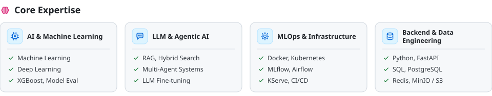
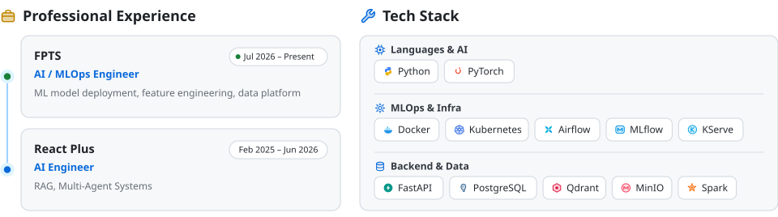

<!-- Chỉnh sửa toàn bộ nội dung chữ, kinh nghiệm, dự án và kỹ năng trong file data/profile.json -->
<!-- Sau khi sửa data/profile.json: chạy `python3 scripts/generate_profile.py` (hoặc push lên Git để GitHub Actions tự cập nhật) -->

  

  <picture>
    <source media="(prefers-color-scheme: dark)" srcset="assets/svg/about-me-dark.svg" />
    <source media="(prefers-color-scheme: light)" srcset="assets/svg/about-me-light.svg" />
    
  </picture>

  <picture>
    <source media="(prefers-color-scheme: dark)" srcset="assets/svg/core-expertise-dark.svg" />
    <source media="(prefers-color-scheme: light)" srcset="assets/svg/core-expertise-light.svg" />
    
  </picture>

  <picture>
    <source media="(prefers-color-scheme: dark)" srcset="assets/svg/experience-stack-dark.svg" />
    <source media="(prefers-color-scheme: light)" srcset="assets/svg/experience-stack-light.svg" />
    
  </picture>

