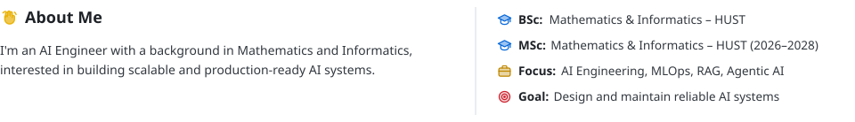
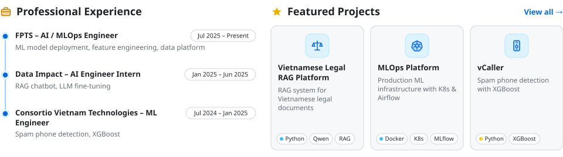
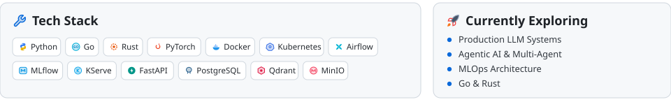
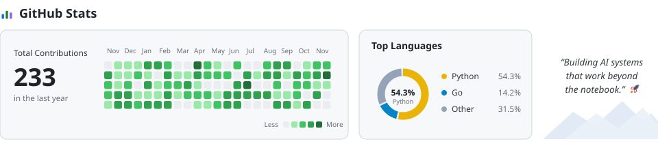

<!-- Chỉnh sửa toàn bộ nội dung chữ, kinh nghiệm, dự án, kỹ năng và GitHub stats trong file data/profile.json -->
<!-- Sau khi sửa data/profile.json: chạy `python3 scripts/generate_profile.py` (hoặc push lên Git để GitHub Actions tự cập nhật) -->

  

  <picture>
    <source media="(prefers-color-scheme: dark)" srcset="assets/svg/about-me-dark.svg" />
    <source media="(prefers-color-scheme: light)" srcset="assets/svg/about-me-light.svg" />
    
  </picture>

  <picture>
    <source media="(prefers-color-scheme: dark)" srcset="assets/svg/core-expertise-dark.svg" />
    <source media="(prefers-color-scheme: light)" srcset="assets/svg/core-expertise-light.svg" />
    
  </picture>

  <a href="https://github.com/GiangGG1116?tab=repositories">
    <picture>
      <source media="(prefers-color-scheme: dark)" srcset="assets/svg/experience-projects-dark.svg" />
      <source media="(prefers-color-scheme: light)" srcset="assets/svg/experience-projects-light.svg" />
      
    </picture>
  </a>

  <picture>
    <source media="(prefers-color-scheme: dark)" srcset="assets/svg/tech-exploring-dark.svg" />
    <source media="(prefers-color-scheme: light)" srcset="assets/svg/tech-exploring-light.svg" />
    
  </picture>

  <a href="https://github.com/GiangGG1116">
    <picture>
      <source media="(prefers-color-scheme: dark)" srcset="assets/svg/github-stats-dark.svg" />
      <source media="(prefers-color-scheme: light)" srcset="assets/svg/github-stats-light.svg" />
      
    </picture>
  </a>

  
  
  

